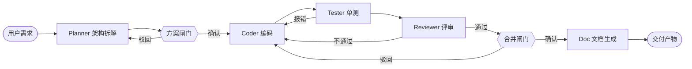

<div align="center">


<h1>multi-agent-coder · 多角色协同 AI 编程助手</h1>

<p>
<b>插件式 · 工作区隔离 · 多角色协同 · 沙箱安全</b><br/>
把「需求拆解 → 架构设计 → 编码 → 单测 → 评审 → 文档」串成一条可断点续跑、可人工介入、可全程审计的自动化链路
</p>

<p>
  
  
  
  
</p>

<p>
  <a href="#-设计主张">设计主张</a> ·
  <a href="#-功能">功能</a> ·
  <a href="#-架构">架构</a> ·
  <a href="#-技术栈">技术栈</a> ·
  <a href="#-沙箱安全">沙箱安全</a> ·
  <a href="#-路线图">路线图</a>
</p>

</div>

> [!WARNING]
> **本仓库目前只有设计文档，没有可运行的代码。**
> 架构、安全模型与四阶段计划已经写完；`backend/`、`frontend/` 等目录尚未提交。
> 下方所有能力均为**设计目标**，请勿当作已实现的功能阅读。

---

## 💡 设计主张

对标 Claude Code、OpenAI Codex 的智能编码能力，但把重心放在**可控性**上：

> 自主编码 Agent 容易做演示，难做审计。真正的难点不是生成，而是**约束**——谁能执行什么、在哪个目录、花多少预算。

所以本项目以 **LangGraph** 为编排内核，图拓扑在编译期固定、角色行为由配置驱动。五个角色（架构师 / 开发 / 测试 / 评审 / 文档）各自是独立的 ReAct 子图，主图只负责路由与调度。

---

## ✨ 功能

| 模块 | 能力 |
|:--|:--|
| 🗂️ **工作区管理** | 多项目新建 / 切换 / 销毁；本地挂载、Git 克隆、上传导入三种来源；文件、会话、沙箱、状态完全隔离 |
| 🧩 **插件化角色** | 架构师 / 开发 / 测试 / 评审 / 文档，各自独立配置模型、提示词、工具白名单与发言权重；**新增角色只加配置，不改核心** |
| 🕸️ **多 Agent 编排** | 主图调度 + 角色子图；支持自由协作讨论与结构化流水线双模式 |
| 🧪 **沙箱执行** | 一工作区一容器；CPU / 内存 / 磁盘与进程数配额；非 root、能力裁剪、只读根文件系统、默认断网 |
| ✅ **人工审批** | 方案闸门与合并闸门两处挂起；命令按安全 / 需审批 / 禁止三级分级；审批事件经 SSE 实时推送 |
| 📈 **可观测与成本** | 事件流全量落库；任务—节点两级链路追踪；按任务 / 工作区 / 角色聚合 token 与费用；超预算熔断 |
| 🔌 **工具与模型** | 工具统一以 MCP Server 提供；LLM 适配层支持每个角色绑定不同供应商 |

---

## 🏗️ 架构

自上而下五层，外加贯穿全链路的可观测与存储层：

```text
┌──────────────────────────────────────────────────────────────┐
│  Web 前端层   工作区管理 · Agent 配置 · 任务控制台 · 事件流 · 审批面板 │
└───────────────────────────────┬──────────────────────────────┘
                                │  REST（控制面）+ SSE（事件流）
┌───────────────────────────────┴──────────────────────────────┐
│  API 服务层   FastAPI · 认证与配额 · 任务调度 · 事件通道              │
└───────────────────────────────┬──────────────────────────────┘
┌───────────────────────────────┴──────────────────────────────┐
│  核心编排层   LangGraph 主图 + 角色子图 · 工作区管理 · 插件配置 · 审批 · 状态 │
└───────────────────────────────┬──────────────────────────────┘
┌───────────────────────────────┴──────────────────────────────┐
│  插件工具层   角色 Agent 插件 · MCP 工具服务 · LLM 适配 · 命令分级      │
└───────────────────────────────┬──────────────────────────────┘
┌───────────────────────────────┴──────────────────────────────┐
│  沙箱隔离层   Docker 容器池 · 资源与进程限制 · 网络代理 · 权限最小化    │
└───────────────────────────────┬──────────────────────────────┘
┌───────────────────────────────┴──────────────────────────────┐
│  可观测与存储  事件流落库 · 链路追踪 · 成本统计 · Postgres 检查点       │
└──────────────────────────────────────────────────────────────┘
```

### 🔄 任务流程



终止由三重机制兜底：**轮次硬上限**、**模型自判完成**、**变更指纹去重**（同一问题反复出现即判定无效循环，输出已有产物后终止）。

---

## 🛠️ 技术栈

<h3 align="center">编排与运行时</h3>

<p align="center">
  
  
  
  
</p>

<h3 align="center">前端与存储</h3>

<p align="center">
  
  
  
  
  
</p>

<h3 align="center">隔离与可观测</h3>

<p align="center">
  
  
</p>

| 层次 | 技术 | 说明 |
|:--:|:--:|:--|
| 编排内核 | LangGraph 1.2.x | 状态图编排，支持分支、循环、人工介入；图拓扑编译期固定 |
| 运行时 | Python 3.12 | 满足 LangGraph 版本要求，兼顾生态与生命周期 |
| 后端框架 | FastAPI | 异步接口，适配 LLM 长调用与多任务并发 |
| 插件机制 | 配置驱动 + Pydantic 校验 | 角色 = 配置 + 提示词 + 工具白名单，不改图即可扩展 |
| 工具协议 | MCP | 工具层标准化，直接复用外部 MCP 生态 |
| 沙箱 | Docker SDK | 容器级资源隔离、权限管控、自动销毁 |
| 前端 | Vue 3 + Vite + Element Plus | 轻量化可视化管控后台 |
| 存储 | SQLite + PostgreSQL 15+ | 配置元数据走 SQLite，状态快照与事件流走 Postgres |
| 状态持久化 | LangGraph Checkpointer | 断点保存、任务续跑、审批挂起 |
| 实时通道 | SSE + REST | SSE 单向推事件，REST 承载启动 / 暂停 / 终止 / 审批 |
| 可观测 | OpenTelemetry / LangSmith | 多 Agent 链路追踪，定位失败节点与成本热点 |
| 模型适配 | OpenAI / Anthropic / 开源模型 | 每个角色可独立绑定不同供应商 |

---

## 🛡️ 沙箱安全

| 关注点 | 措施 |
|:--|:--|
| 资源 | CPU / 内存 / 磁盘配额，限制进程数与文件描述符，防 fork 炸弹 |
| 权限 | 容器内非 root，丢弃全部 capabilities，启用 `no-new-privileges` |
| 文件 | 只挂载当前工作区目录，根文件系统只读 |
| 网络 | 默认阻断公网，依赖安装走内网镜像源或白名单代理 |
| 镜像 | 基础镜像自建并固定 digest，禁用可变标签 |
| 审计 | 文件修改、命令执行、代码运行全程落库，可追溯 |

> 命令白名单只是纵深防御的一层，**主防线是容器隔离本身**。
> 后端通过 Docker SDK 调度容器，等价于持有宿主机较高权限，因此必须运行在独立账户下，不与对外 API 共用进程权限。

---

## 📁 目录结构

```text
project-root/
├── frontend/            # Web 前端项目
├── backend/
│   ├── core/            # 编排核心：主图、路由、调度
│   ├── agents/          # 角色子图（Planner/Coder/Tester/Reviewer/Doc）
│   ├── plugins/         # 角色配置与插件注册表（配置驱动）
│   ├── tools/           # 内置工具实现
│   ├── mcp/             # MCP Server 与工具适配
│   ├── sandbox/         # Docker 沙箱管理、依赖代理、安全策略
│   ├── observability/   # 事件流、链路追踪、成本统计
│   ├── api/             # FastAPI 接口与 SSE 事件通道
│   ├── db/              # 数据模型与迁移脚本
│   └── main.py          # 服务入口
├── evals/               # 任务评测集与评测脚本
├── workspace/           # 工作区文件与状态存储目录
├── config/              # 全局配置、插件配置、模型配置
└── docs/                # 项目文档
```

---

## 🚀 部署环境

- **操作系统**：Linux 首选（容器行为与资源配额最可控）；macOS 可用于开发；Windows 依赖 WSL2，v1 不承诺生产可用
- **依赖**：Python 3.12、Docker 24+、Node 18+、PostgreSQL 15+
- **工作区来源**：本地部署可挂载本地目录；服务器部署仅允许 Git 克隆或上传导入，**不允许挂载宿主机任意路径**

---

## 🗺️ 路线图

| 阶段 | 周期 | 目标 |
|:--:|:--:|:--|
| 一 · 最小可用原型 | 2 周 | 前后端框架、插件注册机制、Planner + Coder 子图、基础沙箱，跑通单工作区端到端 |
| 二 · 核心能力完善 | 3 周 | 补齐 Tester / Reviewer / Doc，分支流转与迭代修复，双审批闸门，沙箱加固 |
| 三 · 稳定性迭代 | 2 周 | 死循环与上下文膨胀、git worktree 隔离与写锁、成本看板与配置备份 |
| 四 · 生态扩展 | 1 周 | 开放插件开发规范、多模型适配、压测与安全测试、完整交付物 |

**阶段一的完成定义**：空目录 + 一句需求，系统能在沙箱内产出可运行代码，自动生成并跑通至少 1 个单元测试，全过程事件在 Web 端实时可见，任务中断后可从检查点续跑。

---

## 📌 设计原则

1. **图固定、角色配置化** —— 扩展新角色不牺牲可调试性，明确不做运行期热加载
2. **状态轻量化** —— 图状态只存引用与摘要，代码与产物落在工作区文件系统，避免检查点随迭代膨胀
3. **全链路可审计** —— 任何文件变更、命令执行、人工审批都留有事件记录，问题能定位到具体节点
4. **量化交付** —— 内置评测集与成本配额，模型与提示词的每次调整都有基线数据支撑

---

<div align="center">

设计先行，代码随后。有源码的那天，这个 README 会被改成「怎么跑起来」。

</div>
